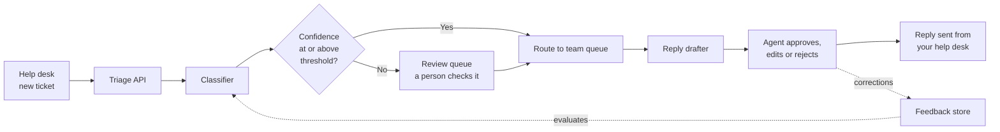

Brightweir Triage sits between your help desk and your support agents. It reads each new ticket, suggests where it should go and drafts a reply. People make every decision that reaches a customer.

## How a ticket flows

## Components

| Component | What it does | Who controls it |
| --- | --- | --- |
| **Triage API** | Receives tickets from your help desk over HTTPS and checks the API key. | Brightweir |
| **Classifier** | Assigns a category and an urgency level, with a confidence score from 0 to 1. | Brightweir. You choose which model version to use. |
| **Confidence gate** | Compares the confidence score with your threshold (0.80 by default) and sets `needs_review`. | You set the threshold. |
| **Review queue** | Holds low-confidence tickets in your help desk until a person routes them. | Your team |
| **Reply drafter** | Writes a draft reply using your knowledge-base articles, and lists the articles it used. | Brightweir |
| **Agent review** | An agent approves, edits or rejects every draft. Nothing is sent automatically. | Your team |
| **Feedback store** | Keeps agent corrections so Brightweir can test new models against real decisions. | Brightweir, with your permission |

## Design decisions

<AccordionGroup>
  <Accordion title="Why a person approves every reply">
    A wrong category costs a few minutes. A wrong reply can cost a customer. The API returns drafts with the status `pending_review` and has no endpoint that sends a message, so a person always decides what reaches a customer.
  </Accordion>
  <Accordion title="Why you pin a model version">
    New models change results. Pinning a version, such as `triage-2026-09`, keeps production stable until you have tested the new one in the sandbox. Deprecated models keep working for at least 12 months. See **List models** in the [API reference](/api-reference/introduction).
  </Accordion>
  <Accordion title="Why corrections do not retrain your model directly">
    Corrections go to the feedback store, not straight into the live model. Brightweir uses them to evaluate the next model version, which you can test before switching. This prevents one bad correction from changing results for everyone.
  </Accordion>
</AccordionGroup>

## Data handling

- Ticket text is encrypted in transit (TLS 1.2 or later) and at rest.
- Ticket text is deleted 30 days after classification unless you send feedback on that ticket.
- You choose the region where data is processed: Canada, the US or the EU.
