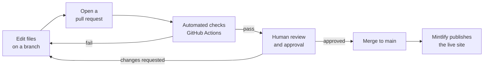

This page is for the people who maintain these docs. It explains how a change goes from an edit to the live site, what is generated automatically, what a person must review and how to extend the site.

## How the pipeline works

Every page on this site is a text file in the [GitHub repository](https://github.com/ClicKnowledge/docs-as-code-demo). Nobody edits the live site directly. Changes go through the same steps every time.

1. **Edit on a branch.** A branch is a private copy of the docs. Work there never affects the live site.
2. **Open a pull request.** This proposes the change and shows exactly what changed, line by line.
3. **Automated checks run.** GitHub Actions runs the checks listed below. A failed check blocks the merge.
4. **A person reviews.** The reviewer uses the checklist in the pull request template.
5. **Merge.** Merging to the `main` branch is the only way content goes live.
6. **Mintlify publishes.** The Mintlify GitHub App sees the merge and rebuilds the site within a few minutes.

## Automated checks

The checks are defined in `.github/workflows/docs-checks.yml` and run on every pull request and every push to `main`.

| Check | Command | What it catches |
| --- | --- | --- |
| Site validation | `mint validate` | Pages that will not build, navigation entries with no file, broken OpenAPI pages |
| OpenAPI validation | `mint openapi-check` | Errors in `api-reference/openapi.yaml` |
| Broken links | `mint broken-links` | Links between pages that point nowhere |
| Terminology | `python scripts/check_terminology.py` | Words that break the terminology standard |

<Note>
  Mintlify offers built-in checks on its paid plans. This site runs the same Mintlify command-line tool inside GitHub Actions instead, which works on any plan and keeps the rules in the repository where they can be reviewed.
</Note>

## What is automatic and what a person reviews

| Content | How it is produced | Who reviews it |
| --- | --- | --- |
| API endpoint pages | Generated by Mintlify from `openapi.yaml` on every build | Nobody edits the pages. Changes to `openapi.yaml` are reviewed by the engineer who changed the API and by the technical writer. |
| API introduction, quickstart, architecture overview | Written by the technical writer | A technical writer, plus an engineer for technical accuracy |
| Datasheet and other commercial content | Written by the technical writer from the technical docs | A technical writer, plus product marketing for claims and positioning |
| Links, page builds, OpenAPI syntax, terminology | Checked automatically | No person needed unless a check fails |
| Content drafted with AI tools | Drafted by AI, then edited by the writer | Always reviewed by a person. Say in the pull request which parts were AI-drafted. |

**The rules:**

- Every pull request needs passing checks and at least one human approval before it merges.
- Generated pages are never edited by hand. Fix the source (`openapi.yaml`) instead.
- Claims about performance, security or pricing need sign-off from the owner of that claim.

## Version control

- **Every change is recorded.** Git keeps the full history of every file: who changed it, when and why. Any change can be undone by reverting its pull request.
- **The API spec has its own version.** The `info.version` field in `openapi.yaml` follows semantic versioning: patch for wording fixes, minor for new endpoints or fields, major for breaking changes.
- **API versions live in the path.** A breaking change means a new path (`/v2`) and a new navigation group, while `/v1` docs stay published until `/v1` retires.

## How to make common changes

<AccordionGroup>
  <Accordion title="Change or add an API endpoint">
    1. Edit `api-reference/openapi.yaml`. In a full setup, the engineering team's own pipeline updates this file when the API code changes, so the docs cannot drift from the product.
    2. If you added an endpoint, add its `METHOD /path` line to the **API reference** group in `docs.json`.
    3. Open a pull request. The OpenAPI and validation checks confirm the spec is valid.
    4. Ask the engineer who owns the endpoint to review it.
  </Accordion>
  <Accordion title="Add a page">
    1. Copy the matching file from `templates/` (guide or concept) and rename it.
    2. Add the page's file name, without `.mdx`, to the right group in `docs.json`.
    3. Preview it on your computer with `mint dev`, then open a pull request.
  </Accordion>
  <Accordion title="Add a second product">
    1. Create a folder for the product, for example `insights/`, with its own `openapi.yaml`.
    2. In `docs.json`, switch `navigation` from `groups` to `tabs` and give each product a tab with its own `openapi` file.
    3. Add the product's terms to `standards/terminology.yml`.
    4. Open a pull request and get review from both product owners.
  </Accordion>
</AccordionGroup>

## Style and terminology standards

- Write in plain language, in the second person ("you"), and in active voice.
- Use sentence case for titles and headings.
- One idea per sentence. Lead with what the reader needs to do.
- Bold the names of things readers click, for example **Settings > API keys**.
- Put code, field names, file names and commands in `code format`.

The approved terms live in `standards/terminology.yml`, and the terminology check enforces them. A few examples:

{/* terminology-check: off */}

| Use | Instead of | Why |
| --- | --- | --- |
| ticket | support case | One name for one thing, matching the API |
| draft reply | suggested response, auto-reply | "Auto-reply" suggests it is sent automatically. It never is. |
| confidence score | certainty score | Matches the `confidence` field |
| agent | rep, CSR | The term our customers use |
| API key | API token | Matches the console and the `Authorization` header docs |
| help desk | helpdesk | One spelling everywhere |

{/* terminology-check: on */}

To add a term, add an entry to `standards/terminology.yml` and open a pull request. The check applies the new rule to every page right away.

## Templates

The `templates/` folder holds starting points for new pages. Mintlify does not publish this folder.

- `guide-template.mdx`: task-based pages such as a quickstart or how-to guide
- `concept-template.mdx`: explanation pages such as an architecture overview

## When a check fails

| Failed check | What it means | How to fix it |
| --- | --- | --- |
| Site validation | A page will not build, or `docs.json` lists a page that does not exist | Open the log in the **Checks** tab of the pull request. It names the file and line. |
| OpenAPI validation | `openapi.yaml` has a syntax or structure error | The log names the line. Fix it, or ask the engineer who made the change. |
| Broken links | A link points to a page that does not exist | Fix the link, or add the missing page |
| Terminology | A page uses a term the standard replaces | Use the term the log suggests |

## Handover checklist

- [ ] New owner has write access to the GitHub repository and admin access to the Mintlify dashboard
- [ ] Branch protection is on for `main`: pull request required, one approval, checks must pass
- [ ] New owner has run `mint dev` on their computer and opened a test pull request
- [ ] Reviewers for API, product marketing and security claims are named
- [ ] The engineering team knows how `openapi.yaml` gets updated when the API changes
